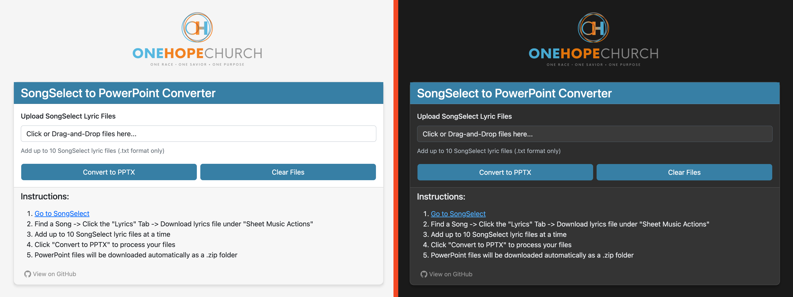
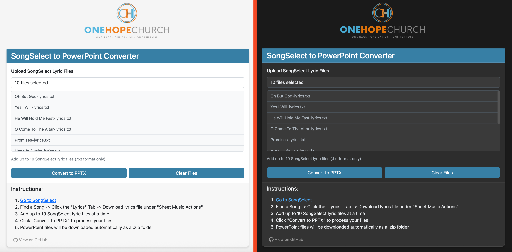
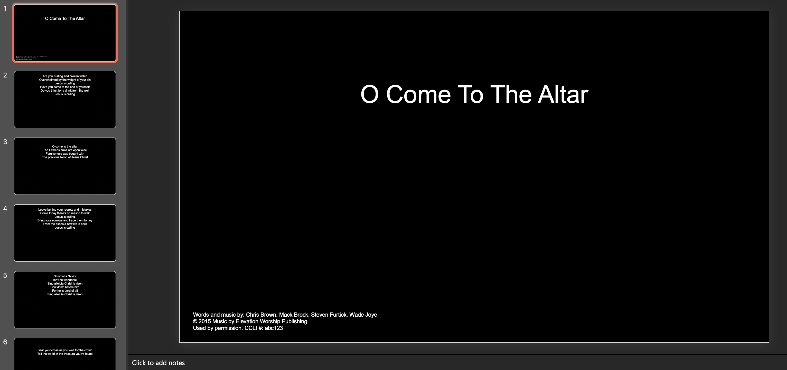
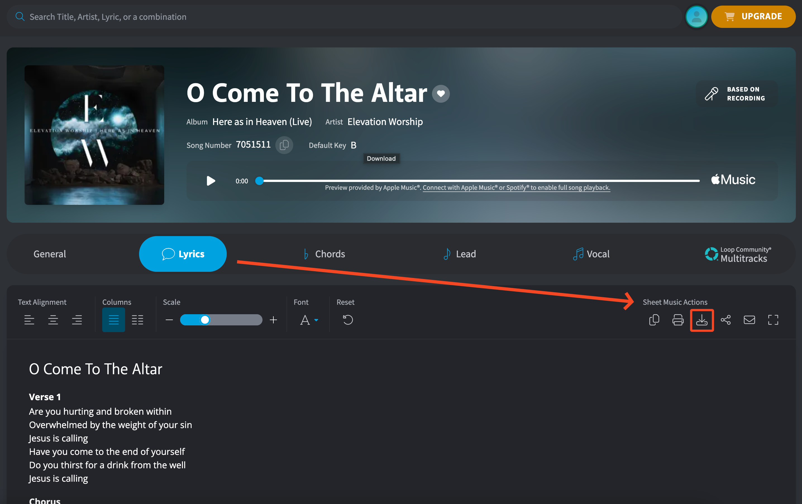

# SongSelect to PowerPoint Converter
A simple web app that converts SongSelect lyric .txt files into PowerPoint .pptx files.
Can be run locally or as a Docker container.

  

> [!CAUTION]
> While this app is a web app, it is designed to be run locally or behind a reverse proxy (preferrably with authentication) and not designed to be exposed to the public internet. Do so at your own risk.

# App Use
  * Add up to 10 SongSelect lyric .txt files at a time
  * Click "Convert to PPTX"
  * Downloaded as a .zip containing the .pptx files  

  

# PPT Slide Formatting
PPT slides are formatted as follows...
  * 16:9 format
  * Solid black background
  * Title slide with proper CCLI copyright formatting
  * Lyric slide follow the title slide with text centered in the top half of the slide  

  

# SongSelect TXT File Format
SongSelect provides lyrics as a standardized .txt file download. This app is designed to use the default lyric file formatting without any modifications. The txt file can be downloaded from the Lyrics tab as seen in the screenshot below.  

> [!NOTE]
> A SongSelect login is required to download lyrics.  

  

# Run the App
> [!IMPORTANT]
> The title slide includes formatted copyright info [as required by CCLI](https://ccli.com/us/en/5-questions) when displaying lyrics. In order to use your CCLI Copyright License number, set an environment variable for `CCLI_LIC_NUM` or else it will be displayed as "None".  

## Run Locally
(Requires Python 3.13 or 3.14; Python 3.14 is used in the container.)
  * Clone the repo
  * Create a virtual environment, then run `python -m pip install --upgrade --require-hashes -r app/requirements-pip.txt` before installing dependencies with `python -m pip install --require-hashes -r app/requirements.txt`
  * Set an environment variable for your CCLI Copyright License number
    * Example: `CCLI_LIC_NUM=abc123`
  * Navigate into the `/app` directory
  * Start Flask with `python3 webapp.py`  

## Run As a Docker Container
An example Docker compose file is included in this repo.  
Start the container using compose with...
```
docker compose up -d
```

Or run directly from Docker with...
```
docker pull ghcr.io/onehopeatl/songselect_lyric_converter:latest
docker run -e "CCLI_LIC_NUM=abc123" -p 127.0.0.1:8080:8080 --name lyric-converter ghcr.io/onehopeatl/songselect_lyric_converter:latest
```  

## Security and maintenance

Runtime dependencies, including indirect dependencies, are pinned with SHA-256
hashes in `app/requirements.txt`. The direct requirements are in
`app/requirements.in`. To review and refresh them using Python 3.14:

```sh
python -m pip install --upgrade --require-hashes -r app/requirements-pip.txt
python -m pip install pip-tools==7.6.2 pip-audit==2.10.1
# Review and update the versions in app/requirements.in first.
pip-compile --upgrade --generate-hashes --strip-extras --index-url https://pypi.org/simple --no-emit-index-url --no-emit-trusted-host --output-file app/requirements.txt app/requirements.in
python -m pip install --require-hashes -r app/requirements.txt
python -m pip check
python -m unittest discover -s tests -v
python -m pip_audit --strict --disable-pip --require-hashes -r app/requirements-pip.txt -r app/requirements.txt
```

CI runs conversion/security regression tests and a dependency audit before
publishing, including a container scan that fails on high or critical vulnerabilities. A separate workflow checks Python 3.13 and 3.14 and the container on
pull requests and weekly. Dependency updates are managed manually using the
commands above.

Uploads are limited to ten UTF-8 `.txt` files, 256 KiB per file and 10 MiB per
request. Songs must have 1–200 lyric sections and lines no longer than 4,000
characters. Each request uses an isolated temporary directory, removed before
the ZIP download starts; the download spool closes after the response finishes.
Song titles are sanitized for output filenames; duplicate titles receive suffixes.
Errors display on the upload page without exposing internal exception details.

The app does not provide authentication. Keep it local or behind an authenticated
reverse proxy. Both Docker examples bind to loopback by default. The compose
example also uses a read-only filesystem, a bounded temporary filesystem, and
no Linux capabilities; the image runs as an unprivileged user.

Forwarded headers are ignored by the app by default. The compose example enables
one trusted reverse proxy with `TRUSTED_PROXY_COUNT=1`; use `0` for direct access.
For other deployments,
set `TRUSTED_PROXY_COUNT` to the exact number of trusted forwarding proxies
(usually `1`). Gunicorn is a server, so it does not count as another proxy. Only
enable this when direct access to the app is blocked and the proxy replaces
client-supplied forwarding headers so that the trusted entries in
`X-Forwarded-For` and `X-Forwarded-Proto` cannot be forged. Forwarded host,
port, and prefix headers are never trusted. Preserve the original `Host` header
at the proxy. Optionally set `TRUSTED_HOSTS` to a comma-separated host allowlist,
such as `lyrics.example.org,localhost` (without URL schemes or ports).

Fresh builds pull the current Python 3.14 Alpine base and apply Alpine package
updates. Existing containers only receive these changes after rebuilding/pulling
and recreating them:

```sh
docker compose pull
docker compose up -d --force-recreate
```

Pip is explicitly pinned with a wheel hash in `app/requirements-pip.txt`, upgraded
before dependency installation in container builds and CI, and included in the
dependency audit. Keep this file current along with the runtime lockfile. New or existing virtual environments must run the pip bootstrap command above.
Use Python 3.13 or 3.14 for this project.
